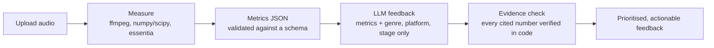
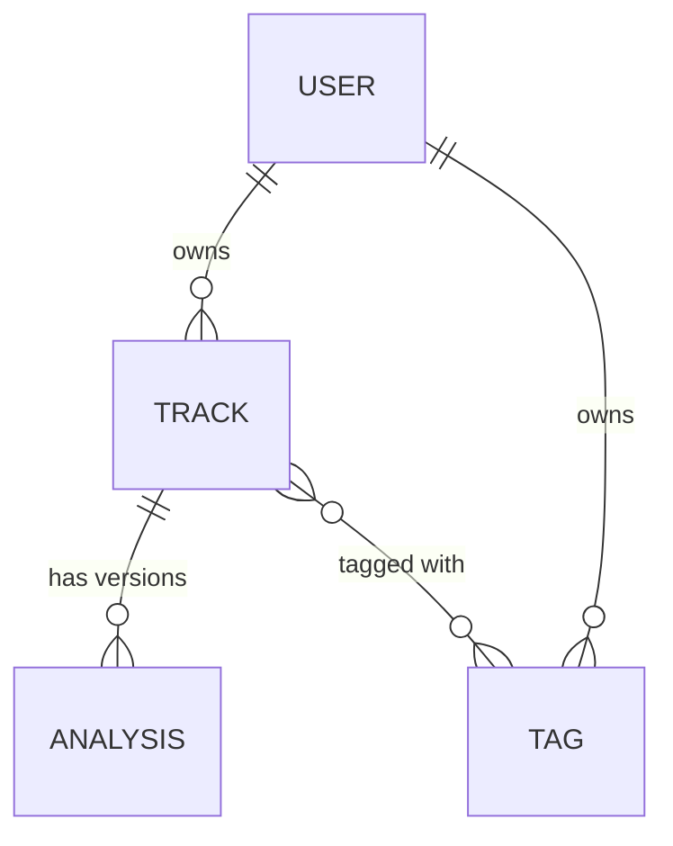

# AI Audio Assistant for Producers

Upload a track, get **measured** audio metrics, and receive **AI-written, actionable feedback** that is checked against those measurements before you see it.

This is my final bootcamp project and a portfolio piece aimed at audio AI and plugin work. Correct, explainable audio measurements matter more here than flashy features, so the design starts from one rule.

## The idea: measure with DSP, explain with the LLM

The language model never "listens" to audio and is never trusted with numbers.



- **Measurement is deterministic DSP.** Loudness, dynamics, spectrum, stereo, tempo and key are computed by code I can test and compare against meters I trust.
- **The LLM only explains.** It receives the metrics JSON plus the track's genre, target platform and stage, and nothing else: not the audio, not the file name, not free-text notes.
- **Every claim is verified.** Each feedback item cites a metric by path and value. The server checks those citations against the stored metrics, retries once if they are wrong, and otherwise refuses to return the feedback (502) instead of showing invented numbers.
- **Uncertain measurements stay uncertain.** Tempo and key are suggestions that always carry a confidence value. When confidence is low, the related feedback is clamped to low priority.

## What it does

- Accounts with email and password, and token authentication.
- Tracks with title, genre, target platform, notes and tags, with full create, read, update and delete.
- One **analysis per uploaded version** of a track (demo, mix or master), so versions can be compared over time.
- Background analysis with a status to poll (`pending`, `running`, `done`, `failed`).
- AI feedback on any finished analysis, generated on demand.
- The uploaded audio is a temporary file that is **deleted as soon as analysis finishes**. Only the metrics JSON is stored.

The React and TypeScript frontend (upload, waveform, results cards, version list) is the next milestone. This repository currently contains the analysis engine and the API.

<!-- Add screenshots here once the frontend exists. -->

## What gets measured

| Metric group | How it is measured |
|---|---|
| Loudness: integrated, short-term max, momentary max, loudness range, true peak | ffmpeg's `ebur128` filter (`backend/analysis/loudness.py`) |
| Tempo and key | essentia, on audio decoded to mono float32 at 44.1 kHz. Both always come with a confidence value |
| Spectrum | Energy per octave band, relative to the average across bands (pink-referenced: pink noise reads 0 dB everywhere, real music slopes down, so compare against genre reference curves) |
| Dynamics | `dynamic_range_db`: an approximation of the DR-meter idea. Per channel, the second-highest 3 s block peak against the RMS of the loudest 20% of blocks. **Not** a certified DR14 reading |
| Stereo | `width` is the share of energy in the side signal (0 mono, 0.5 unrelated channels, 1 inverted). `mono_compatible` means the average correlation is above -0.1 |

Spectrum, stereo and dynamics use the first 600 s of the file, tempo and key the first 240 s. A warning is added to the result when a file is truncated. Every result validates against `schema/metrics.schema.json`. The analysis package is pure and framework-free (path in, plain dict out), so the same measurements could later be reimplemented in C++/JUCE against the same schema.

## How honest are the numbers?

Loudness was compared against four independent meters (Youlean, the DAW's meter, SPAN and WLM) on one track:

| | This project | Reference meters |
|---|---|---|
| Integrated loudness | -10.4 LUFS | -10.3 / -10.5 LUFS |
| Short-term max | -8.3 LUFS | -8.3 LUFS |
| Momentary max | -7.8 LUFS | -7.7 / -7.8 LUFS |
| Loudness range | 4.3 LU | 4.3 LU |
| True peak | +1.2 dBTP | +1.2 to +1.3 dBTP |

Not verified yet, and flagged as such:

- Spectrum bands, stereo width and correlation have not been compared against a meter. RMS disagrees with SPAN's live readout (-12.07 here against -13.6/-13.7) and is still being investigated.
- Dynamic range is an approximation with its own definition, so it is not comparable with DR14 meters.
- Tempo and key were checked on two tracks (123.7 against a true 124 BPM with the key correct, and 128 BPM correct at confidence 0.54). The reliability thresholds that clamp low-confidence feedback are placeholders calibrated on that small sample.

The reasoning behind each measurement choice is in [`docs/DECISIONS.md`](docs/DECISIONS.md).

## AI feedback

- Provider: Gemini free tier, behind a `FeedbackGenerator` interface in `backend/app/services/feedback/`. Another provider is one extra class. This is a portfolio project, so it deliberately needs no paid key.
- Output is structured JSON (`summary` plus items with area, severity, observation and suggestion), validated with Pydantic.
- Platform loudness differences (Spotify -14 LUFS, Apple Music -16, YouTube -14, EBU R128 broadcast -23, true-peak ceiling -1 dBTP) are computed in code and cited like measurements. The reference table lives in `references.py` in the feedback service.
- At the demo and mix stages, loudness items are capped at medium priority in code, not only in the prompt, because loudness is a mastering concern.
- A failed feedback call never changes the analysis or its previous feedback.

## Architecture

```
backend/
  analysis/      pure measurement functions, one module per metric group, plus a CLI
  app/           FastAPI application
    routers/     auth, users, tracks, analyses
    services/    background analysis runner, feedback generation and verification
    ...          config, db, models, schemas, security, error handling, rate limits
  alembic/       database migrations
  tests/
frontend/        React + TypeScript (next milestone)
schema/          metrics.schema.json
docs/            API.md (API plan as built), DECISIONS.md (decision log)
```

Data model:



Upload flow: validate extension and size, stream to a randomly named temp file, create the analysis row (`pending`) and answer `202`. A background task then runs the analysis (`running`, then `done` or `failed`), stores the metrics and deletes the temp file in a `finally` block. The client polls `GET /analyses/{id}`.

Stack: Python 3.12+ (developed on 3.14), FastAPI, SQLAlchemy 2.0, Pydantic v2, Alembic, SQLite, essentia, numpy and scipy, ffmpeg, pytest.

## Quickstart

Requirements: Python 3.12 or newer and `ffmpeg` on your PATH (`brew install ffmpeg` on macOS, `apt install ffmpeg` on Debian or Ubuntu). `pip install essentia` works on Linux and macOS; on Windows use WSL.

```bash
cd backend
python -m venv .venv && source .venv/bin/activate
pip install -r requirements-dev.txt

cp .env.example .env
# set JWT_SECRET, for example:
python -c "import secrets; print(secrets.token_urlsafe(48))"

alembic upgrade head              # creates the database tables
uvicorn app.main:app --reload     # API on http://127.0.0.1:8000, interactive docs at /docs
```

AI feedback needs a Gemini API key (Google AI Studio). Put it in `.env` as `GEMINI_API_KEY`, and set `GEMINI_MODEL` to a current model name. Without a key everything else works and `POST /analyses/{id}/feedback` answers `503 not_configured`.

Analyse a file without the API:

```bash
python -m analysis.cli ../samples/my_track.wav --genre "house" --platform spotify --stage mix
# --skip-tempo-key skips essentia
```

Tests and linting:

```bash
pytest                            # 370+ tests; one opt-in live test is skipped by default
ruff check . && ruff format .
```

## Configuration

All settings are environment variables, optionally in `backend/.env`. See `backend/.env.example`.

| Variable | Default | Meaning |
|---|---|---|
| `ENVIRONMENT` | `development` | Anything else requires a real `JWT_SECRET` |
| `DATABASE_URL` | `sqlite:///./app.db` | SQLAlchemy URL |
| `JWT_SECRET` | dev-only value | Signing secret for access tokens |
| `ACCESS_TOKEN_MINUTES` | `30` | Access token lifetime |
| `CORS_ORIGINS` | Vite dev origins in development, none otherwise | Comma-separated frontend origins. `*` is rejected |
| `MAX_UPLOAD_MB` | `100` | Largest audio upload |
| `MAX_REQUEST_BODY_KB` | `256` | Largest body for every other request |
| `RATE_LIMIT_ENABLED` | `true` | Master switch for rate limiting |
| `RATE_LIMIT_REGISTER` | `5/hour` | Per client IP |
| `RATE_LIMIT_LOGIN` | `10/minute` | Per client IP, every attempt counts |
| `RATE_LIMIT_UPLOAD` | `20/hour` | Per user |
| `RATE_LIMIT_FEEDBACK` | `10/hour` | Per user |
| `RATE_LIMIT_FEEDBACK_GLOBAL` | `200/day` | Shared by all users (protects the free-tier quota). Empty disables it |
| `RATE_LIMIT_DELETE_ACCOUNT` | `5/hour` | Per user |
| `MAX_TRACKS_PER_USER` | `200` | Track quota |
| `MAX_ANALYSES_PER_TRACK` | `50` | Versions per track |
| `MAX_ACTIVE_ANALYSES_PER_USER` | `2` | Pending plus running analyses per user |
| `MAX_ACTIVE_ANALYSES_GLOBAL` | `10` | Pending plus running across all users, beyond which uploads get `503` |
| `MAX_CONCURRENT_ANALYSES` | `2` | Analyses running at once (ffmpeg and essentia are CPU heavy) |
| `FEEDBACK_PROVIDER` | `gemini` | Only `gemini` is implemented |
| `GEMINI_API_KEY`, `GEMINI_MODEL` | unset | Feedback provider settings |
| `FEEDBACK_TIMEOUT_SECONDS`, `FEEDBACK_MAX_TOKENS` | `60`, `8192` | Feedback call limits |

Rates are written `COUNT/PERIOD` with the period one of `second`, `minute`, `hour` or `day`. A typo fails at startup.

## API overview

Interactive documentation is served at `/docs`. The full plan, with rules and error codes, is in [`docs/API.md`](docs/API.md).

| Method and path | Purpose |
|---|---|
| `POST /auth/register`, `POST /auth/login` | Create an account, get a bearer token |
| `GET /users/me`, `DELETE /users/me` | Current user; delete the account and all its data (needs the password) |
| `POST /tracks`, `GET /tracks`, `GET/PATCH/DELETE /tracks/{id}` | Track CRUD with tags, search and paging |
| `POST /tracks/{id}/analyses`, `GET /tracks/{id}/analyses` | Upload a version (returns 202), list versions |
| `GET/PATCH/DELETE /analyses/{id}` | Status, metrics and feedback; edit label or stage; delete a version |
| `POST /analyses/{id}/feedback` | Generate (or regenerate) AI feedback |
| `GET /health` | Liveness check |

Every error has one shape, with a stable machine-readable code:

```json
{"error": {"code": "not_found", "message": "Track not found"}}
```

## Security and privacy

- Passwords are hashed with Argon2. Login failures give one generic message, and unknown emails take about as long to answer as wrong passwords.
- Access tokens are short-lived JWTs (30 minutes). User ids are never reused, so a token from a deleted account can never authenticate as someone else.
- Every query is filtered by the current user. Another user's resource returns `404`, not `403`, so ids cannot be probed.
- Deleting an account requires the password, and the database cascades the deletion to everything the user owns.
- Audio files are written to randomly named temp files (the client's file name is only a label), size-limited, and deleted after analysis. Their contents are never logged.
- ffmpeg is always called with an argument list and a timeout, never through a shell.
- Unexpected errors return a generic `500` with a request id. The traceback goes to the server log only.
- CORS allows only the configured frontend origins, and 413, 429 and 500 responses keep their CORS headers so the frontend can read them.
- Rate limits, quotas and capacity caps protect the CPU and the free-tier AI quota.

## Database and migrations

The schema is managed by Alembic. The app does not create tables itself; if they are missing it refuses to start with a message telling you to run the migrations.

```bash
alembic upgrade head                              # apply migrations
alembic revision --autogenerate -m "add x to y"   # after changing a model; review the file it writes
alembic downgrade -1                              # undo the last migration
```

A test runs the migrations on a fresh database and compares the result with the models, so a model change without a migration fails the test suite.

## Running it for real: assumptions and limits

- **Single process.** Background tasks, the rate limiter and the analysis concurrency cap live in memory. A restart resets rate-limit counters, and analyses left running by a previous process are marked `failed` (`interrupted`) at startup. Several workers would each count separately; scaling out means a job queue and a shared store such as Redis.
- **Reverse proxy.** Put a request-body limit on the proxy that matches `MAX_UPLOAD_MB`: the application rejects oversized bodies, but only after they have reached it. Run uvicorn with `--proxy-headers` and `--forwarded-allow-ips` set to the proxy, otherwise per-IP limits see the proxy's address for every client.
- **SQLite.** Fine for a demo. `DATABASE_URL` allows moving to Postgres.

## Roadmap

- React and TypeScript frontend: upload with progress, waveform (wavesurfer.js), results cards, version list with edit and delete, optional follow-up chat.
- Verify spectrum, stereo and RMS against a meter; calibrate tempo and key reliability on more tracks, including half-time ones.
- Genre reference curves for the spectrum.
- Version comparison endpoint (`GET /tracks/{id}/compare`).
- Refresh tokens, a job queue, Postgres.

Out of scope for now: a DAW plugin, audio generation, stem separation and sample-library search.

## Project documents

- [`docs/API.md`](docs/API.md): the API and data model as built.
- [`docs/DECISIONS.md`](docs/DECISIONS.md): the decision log, including what changed and why.

<!-- License: not chosen yet. Add one before publishing. -->
